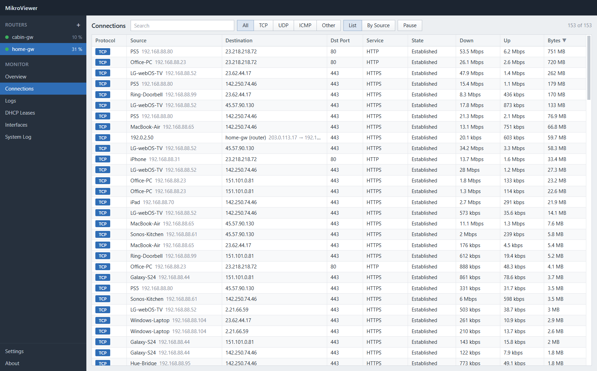
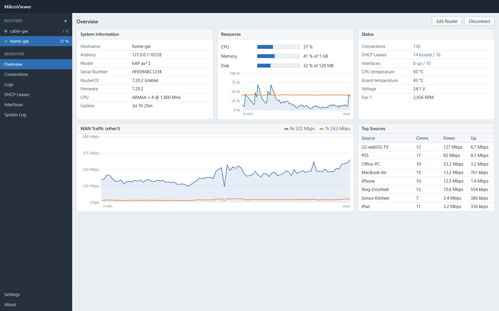
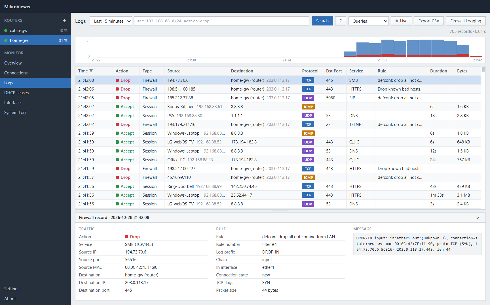
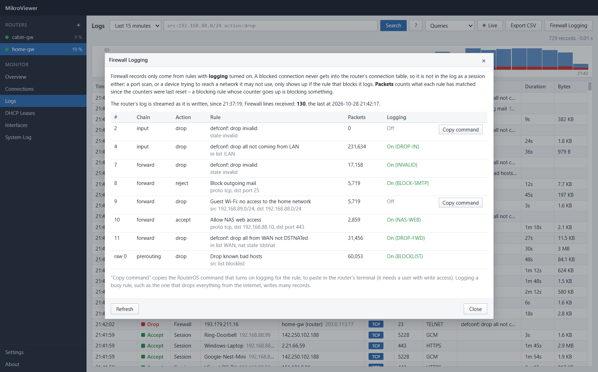
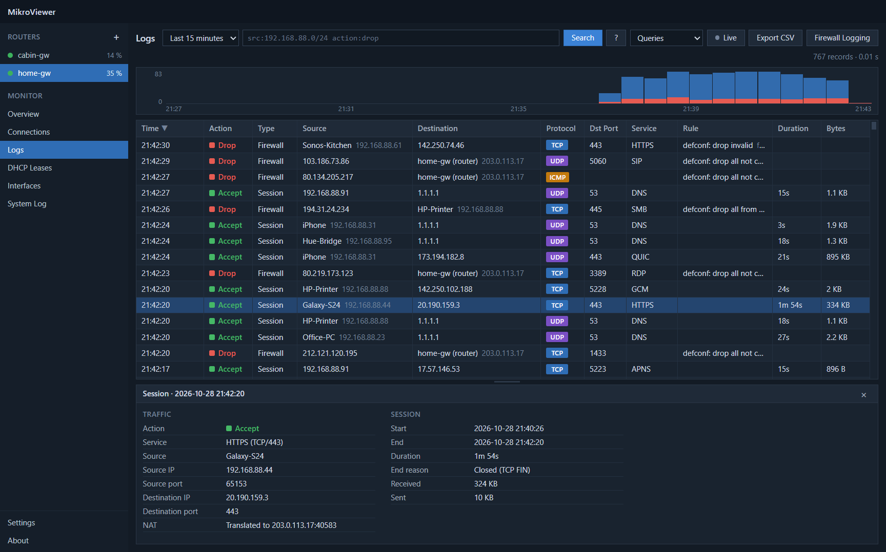

# MikroViewer

A desktop program for monitoring MikroTik routers. It runs entirely on your own computer and talks directly to the router's API – no server, no cloud, nothing to host.



## What it shows

- **Overview** – system information, CPU, memory, disk, temperature and other sensors, WAN traffic and the most active devices
- **Connections** – live connection table: protocol, source, destination, port, service, state and current traffic. Can be grouped by source.
- **Logs** – a firewall-style log of ended sessions and firewall records, with search, time ranges and a timeline (see [Logs](#logs))
- **DHCP Leases** – IP, MAC, hostname, status and expiry
- **Interfaces** – status, current traffic and totals
- **System Log** – the router's own log

Several routers can be added. They stay connected at the same time, and you switch between them in the menu on the left. Right-click a router to connect, disconnect or edit it.

Right-click any cell in a table to copy its value, or the whole row. The mouse's back button (or Alt+Left) returns to where you were – for example from a device's connections back to DHCP Leases.

| Overview | Logs |
| --- | --- |
|  |  |
| **Firewall Logging** | **Dark theme** |
|  |  |

The screenshots show the simulated router that comes with the project ([Demo](#demo-without-a-router)).

## Getting started

### 1. Prepare the router

MikroViewer only reads from the router. Create a user that can only read:

```
/user add name=mikroviewer group=read password=YourPassword
```

Then enable the API. Use **api-ssl** (encrypted) if you can, or plain **api** on a trusted network.

#### api-ssl (encrypted, recommended)

api-ssl needs a certificate on the router. A self-signed certificate is fine:

```
/certificate add name=api-ssl common-name=api-ssl days-valid=3650
/certificate sign api-ssl
/ip service set api-ssl certificate=api-ssl disabled=no
```

Signing can take a minute on small routers. `/certificate print` shows the certificate with the flags `K` (private key) and `T` (trusted) when it is ready.

Optionally, turn off the unencrypted API and only allow your own network:

```
/ip service disable api
/ip service set api-ssl address=192.168.88.0/24
```

In MikroViewer, tick **Use TLS (api-ssl)** when adding the router (port 8729). The certificate is remembered on the first connection; if it changes later, MikroViewer refuses to connect. If you replaced the certificate yourself, edit the router and tick **Reset saved certificate**.

#### api (unencrypted)

```
/ip service enable api
```

Port 8728. The password is sent unencrypted, so only use this on a network you trust.

### 2. Install MikroViewer

Download the latest version from [Releases](https://github.com/dabhans/MikroViewer/releases). Run `MikroViewer-Setup-<version>.exe`, or use `MikroViewer-<version>-portable.exe`, which runs without installation.

The program is not code-signed, so Windows SmartScreen may show a warning the first time. Choose **More info → Run anyway**.

### 3. Add the router

Click **+** next to **Routers**, then enter the router's address, username and password. Use **Test** to check the connection, then **OK**.

## Logs

The log has two kinds of records:

- **Sessions** – every connection through or to the router, written when it ends, like a firewall's traffic log: source, destination, port, service, NAT, start, end, duration, bytes and how it ended (closed, reset or timed out). Connections that are still open are under **Connections**.
- **Firewall** – packets logged by firewall rules with logging turned on, with the action (Accept, Drop, Reject …), the rule's comment, chain and interfaces.

### Blocked traffic

Blocked connections never get into the router's connection table, so they never show up as sessions. A port scan from the internet, or a device trying to reach a network it may not use, is only in the log if the rule that blocks it has logging turned on – RouterOS doesn't log anything by default.

**Firewall Logging** (top right in Logs) shows whether the router's log arrives, and lists the drop and reject rules: whether each one logs and how many packets it has matched. A blocking rule whose counter goes up is blocking something. **Copy command** copies the RouterOS command that turns logging on for a rule. For example, to log what the default firewall drops from the internet:

```
/ip firewall filter set [find comment="defconf: drop all not coming from LAN"] log=yes log-prefix="DROP-IN"
```

Give each logging rule its own log prefix, so MikroViewer can tell which rule wrote a record and show its comment under **Rule**. Sessions have no rule: RouterOS doesn't record which rule let a connection through.

### Searching

Pick a time range, type a query and press Enter. Right-click a cell to filter by (or exclude) its value, drag across the timeline to zoom in, and click a record to see all its details – drag the bar above the details to make them taller. **Queries** has ready-made searches, and **?** lists every field.

| Query | Finds |
| --- | --- |
| `src:192.168.88.23` | traffic from one device (also a name: `src:iphone`) |
| `src:192.168.88.0/24` | a whole subnet |
| `dst:*.netflix.com` | wildcards |
| `port:443`, `port:1-1024`, `port>1024` | destination ports |
| `service:https`, `proto:udp` | services and protocols |
| `action:drop`, `action:block` | dropped (and rejected) traffic |
| `type:firewall`, `type:session` | one kind of record |
| `rule:"drop all"`, `chain:input`, `in:ether1` | firewall rules and interfaces |
| `nat:dstnat` | port forwards |
| `bytes:>100M`, `duration:>1h` | large or long sessions |

Terms next to each other must all match. `OR`, `NOT` and parentheses work as usual, and `field:a,b` matches either value: `(port:80 OR port:443) NOT src:192.168.88.10`.

**Live** shows new records as they arrive. While you scroll down or look at a record, new records wait behind a "new" button so the list doesn't move.

## Settings and updates

**Settings** (bottom left) has the light or dark theme and how long logs are kept. **About** shows the version and checks for updates. The installed version downloads and installs updates itself; the portable version links to the download page.

## Good to know

- **Logs are collected while MikroViewer runs.** Sessions are found by reading the connection table every 3 seconds, so very short connections can be missed. A connection that ends while MikroViewer is disconnected is logged when it reconnects, with the end marked as unknown. Firewall records arrive as the router writes them.
- **Stored logs:** in `%APPDATA%\MikroViewer\logs`, one file per router per hour, kept for 7 days by default (Settings). They contain IP addresses, names and traffic of the devices on the network.
- **RouterOS versions:** RouterOS 6 and 7, including 7.20 and newer, where the connection table has separate port fields.
- **Busy routers:** above 20,000 simultaneous connections, only the count is shown, to avoid loading the router.
- **Domain names** come from the router's DNS cache, so they're only shown when the devices use the router as their DNS server, as in RouterOS' default configuration. Devices that ask another DNS server show IP addresses only. Device names come from DHCP leases.
- **IPv4 only:** connections are read from the IPv4 connection tracking table.
- **Router profiles:** saved in `%APPDATA%\MikroViewer\routers.json`. Passwords are encrypted with Windows' own encryption (DPAPI).

## Building from source

Requires Node.js 22 or newer.

```bash
npm install
```

```bash
npm run dev
```

Build the installer and portable exe into `dist/`:

```bash
npm run dist
```

### Demo without a router

The project includes a simulated router with realistic data, firewall rules and firewall log lines:

```bash
npm run mock
```

Then add a router with address `127.0.0.1`, port `8728`, user `admin` and password `admin`. `--ros719` or `--ros6` simulates older RouterOS versions (ports inside the address fields). `--no-dns` lets the devices use an outside DNS server, so no domain names are shown, as in the screenshots.

### Publishing an update

The installed app looks for updates in this repository's releases (configured in `electron-builder.yml` and `src/main/updater.ts`).

1. Commit your changes, then set the new version: `npm version minor` (or `patch`). This commits the version number and tags it.
2. Build and publish, using your GitHub CLI login (`gh auth login`):

```bash
npm run release
```

The script pushes the commit and tag, builds, and publishes the release with notes listing the changes since the previous release. Edit the notes on GitHub afterwards if you like.

Versions up to 0.2.1 look for updates in `dabhans/MikroViewer-releases`, so the script copies each release there too. Archive that repository on GitHub when those versions are no longer in use, and the copying stops.
